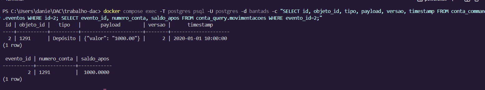
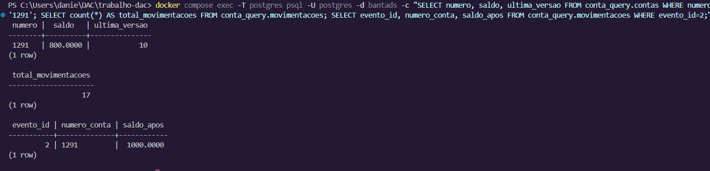
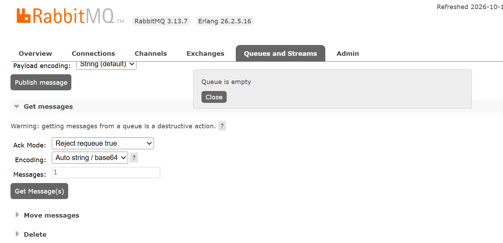
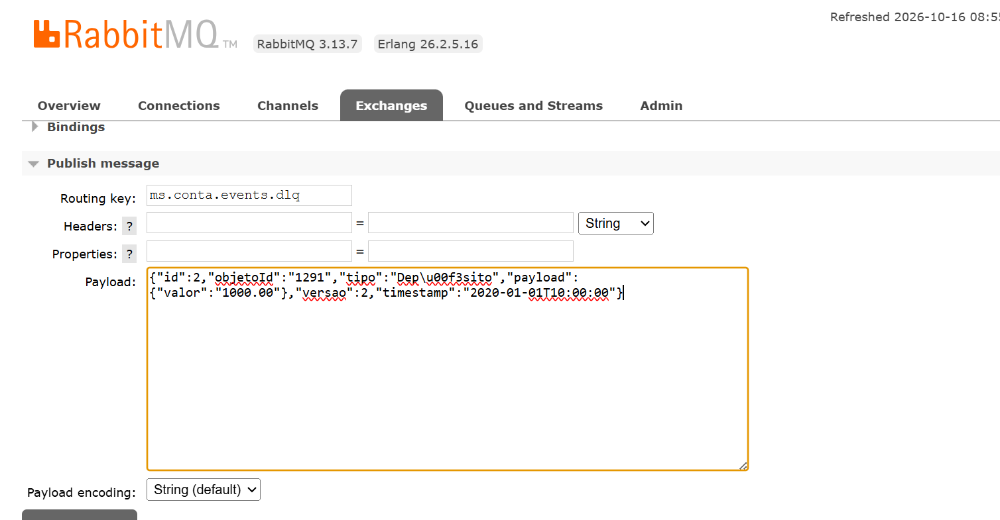
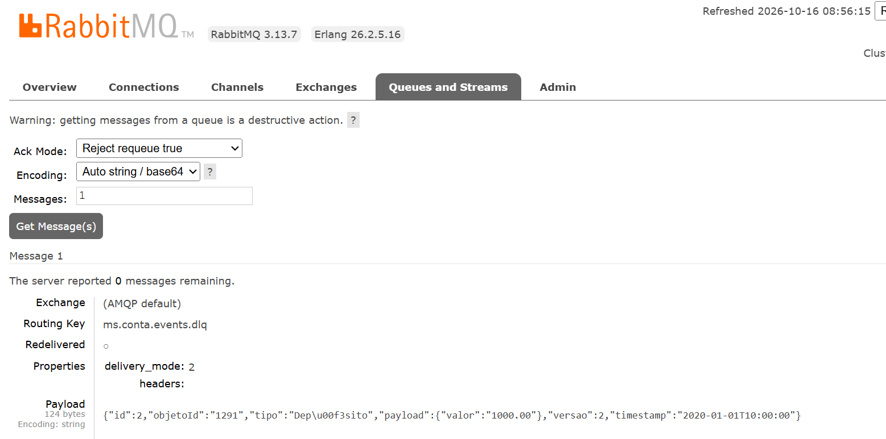
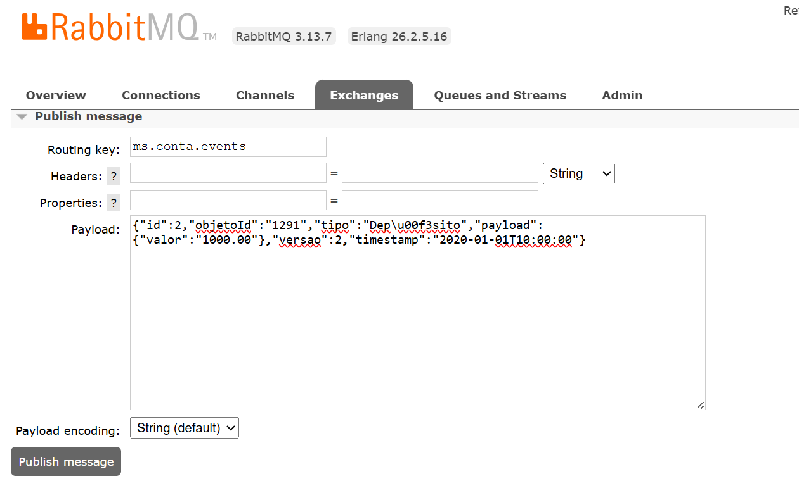
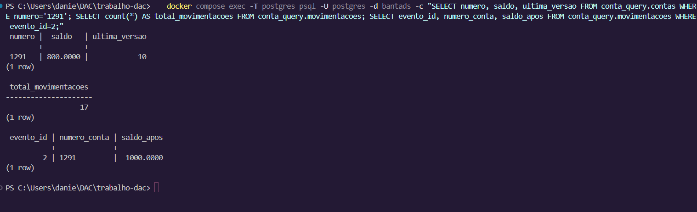

# Ensaio manual: reprocessar um evento da DLQ sem alterar o read model

Este roteiro reproduz pelo console do RabbitMQ o ensaio com uma cópia controlada
do evento `2`, já aplicada ao read model. As capturas do console e do PostgreSQL
estão em `evidencias-reprocessamento/` e aparecem junto aos passos correspondentes.
No ensaio, a mensagem foi publicada na fila original. A captura da reinjeção
foi feita antes do clique e não registra a confirmação de roteamento.

## Preparação

1. Na raiz do projeto, inicie somente os serviços necessários:

   ```powershell
   docker compose up -d --build ms-conta
   docker compose ps postgres rabbitmq ms-conta
   ```

   Espere os três aparecerem como `healthy`. Não execute `/reboot`, seed ou
   limpeza das tabelas durante o ensaio.

2. Abra `http://localhost:15672` e entre no RabbitMQ. No Compose local, o
   usuário e a senha são `guest`/`guest`.

3. Confirme no PostgreSQL que o evento escolhido já foi aplicado:

   ```powershell
   docker compose exec -T postgres psql -U postgres -d bantads -c "SELECT id, objeto_id, tipo, payload, versao, timestamp FROM conta_command.eventos WHERE id=2; SELECT evento_id, numero_conta, saldo_apos FROM conta_query.movimentacoes WHERE evento_id=2;"
   ```

   Na base usada na prova, o evento `2` é um depósito de `1000.00` na conta
   `1291`, versão `2`. Se a sua base não contiver esse evento **nas duas
   tabelas**, escolha outro evento de movimentação já aplicado e adapte o
   payload, a conta e o ID nos passos seguintes.

   

4. Salve uma captura do estado **antes**:

   ```powershell
   docker compose exec -T postgres psql -U postgres -d bantads -c "SELECT numero, saldo, ultima_versao FROM conta_query.contas WHERE numero='1291'; SELECT count(*) AS total_movimentacoes FROM conta_query.movimentacoes; SELECT evento_id, numero_conta, saldo_apos FROM conta_query.movimentacoes WHERE evento_id=2;"
   ```

   Na execução registrada: saldo `800.0000`, `ultima_versao=10`, contagem
   `17` e `saldo_apos=1000.0000`. Anote os valores da **sua** base; eles são
   a referência para a comparação final.

   

## Colocar uma cópia na DLQ

5. Em **Queues and Streams**, abra `ms.conta.events.dlq`. Confira se há
   mensagens. Se houver, não consuma nem substitua mensagens desconhecidas:
   examine a causa da falha e escolha uma mensagem já projetada. Se a DLQ
   estiver vazia, crie uma cópia controlada do evento `2` como nos passos 6–7.

   

6. Em **Exchanges**, abra **(AMQP default)** e a seção **Publish message**.
   Use a routing key `ms.conta.events.dlq`, propriedades vazias e o payload
   abaixo. O `\u00f3` representa o `ó` de `Depósito` em JSON e evita erro de
   codificação. Copie o JSON integralmente, sem trocar `id` ou `versao`:

   ```json
   {"id":2,"objetoId":"1291","tipo":"Dep\u00f3sito","payload":{"valor":"1000.00"},"versao":2,"timestamp":"2020-01-01T10:00:00"}
   ```

   Clique em **Publish message** e confira a confirmação de roteamento.
   Uma publicação sem roteamento não cria a mensagem na DLQ.

   

7. Volte a `ms.conta.events.dlq`. Em **Get messages**, peça **1** mensagem
   com a opção de **requeue** ativada e clique em **Get Message(s)**. Confira
   `id=2`, `objetoId=1291`, `versao=2`, tipo `Depósito` e valor `1000.00`.
   Copie o payload exatamente como aparece e tire o primeiro print. A opção
   de requeue mantém a mensagem na DLQ.

   

## Reinjetar e provar a idempotência

8. Para reproduzir a retirada feita na prova, use **Get messages** novamente
   com quantidade **1** e confirmação/ack **sem requeue**. Antes de confirmar,
   mantenha uma cópia local do payload: a retirada da DLQ e a publicação na
   fila original são duas ações separadas. Confira que a mensagem retirada
   possui o mesmo `id` e payload do passo 7.

9. Em **Exchanges → (AMQP default) → Publish message**, use a routing key
   `ms.conta.events`. Cole o payload retirado da DLQ, sem alterar campos,
   e publique **uma vez**. Tire um print da confirmação de roteamento.

   

   No ensaio, a publicação foi realizada após esta captura. A imagem registra
   o payload e a routing key preparados, mas não a confirmação de roteamento.
   Na defesa, capture também essa confirmação.

10. Aguarde `ms-conta` consumir a mensagem e execute a mesma consulta SQL do
    passo 4. Tire um print da saída **depois**. Os quatro valores — `saldo`,
    `ultima_versao`, `count(*)` e `saldo_apos` — devem ser iguais aos de antes.
    No ensaio registrado, permaneceram `800.0000`, `10`, `17` e `1000.0000`.

    

11. Confira que `ms.conta.events.dlq` não recebeu de volta o evento. Se ele
    reaparecer, consulte `docker compose logs ms-conta` e investigue a causa
    antes de tentar novamente. Não publique repetidamente por causa de atraso
    na atualização da interface.


